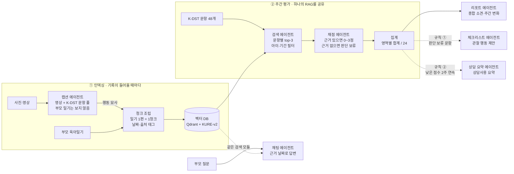

# MORU: 육아기록 기반 영유아 발달 관찰 멀티 에이전트

> **부모가 매일 남긴 일기와 영상 속 발달 단서를 K-DST 문항에 매핑하고, 근거가 부족하면 판단을 보류해 환각을 줄인다.**

**웹 데모:** <https://ye1-oo.github.io/moru/>

MORU의 점수는 **참고 평가값**이며 공식 K-DST 결과나 의학적 진단이 아니다.

---

## 왜 MORU인가

발달지연은 전체 소아의 약 5~10%에서 나타나고([대한소아신경학회지, 2005](https://scholar.kyobobook.co.kr/article/detail/4010022738025)), 영유아 건강검진에서 심화평가 권고를 받는 비율은 2017년 1.82%에서 2021년 2.43%로 해마다 늘었다([세계타임즈, 2023](https://thesegye.com/news/view/1065590770059427)). 그런데 발달장애는 평균 7.3세에 처음 발견되고 11.8세에야 진단된다([한국보건사회연구원, 2022](https://www.kihasa.re.kr/news/card/view?seq=49729)). 진단 기관의 대기 기간은 최장 532일에 이른다([매일신문, 2025](https://www.imaeil.com/page/view/2025102918022185173)).

국가 검진은 6~12개월 간격의 시점 평가이고, 보호자가 검진 당일의 기억으로 문항에 답한다. **검진과 검진 사이, 부모가 매일 보는 아이의 모습은 어디에도 평가되지 않는다.**

MORU는 이 공백을 부모가 이미 쓰고 있는 육아일기와 영상으로 메운다. 새로운 검사지를 풀게 하지 않는다.

여기서 가장 위험한 것은 **AI가 모르는 것을 아는 척하는 것**이다. 기록이 없는 영역을 "발달이 늦다"고 판단하면 부모의 불안만 키운다. 그래서 MORU는 처음부터 다음 원칙으로 설계했다.

> **근거가 있으면 근거와 함께 판단하고, 근거가 없으면 판단을 보류한 뒤 무엇을 관찰할지 안내한다.**

### K-DST란

**K-DST(한국 영유아 발달선별검사)** 는 발달에 문제가 있을 수 있는 영유아를 일찍 찾아내기 위해 보건복지부와 질병관리본부 후원으로 2014년에 개발된 부모 보고식 검사다. 생후 4~71개월 아이가 받는 국가 영유아 건강검진에서 쓰인다([질병관리청, K-DST 사용지침서](https://kdca.go.kr/bbs/kdca/55/259125/download.do)).

- **월령별 검사지:** 아이의 월령 구간마다 다른 문항 세트를 쓴다. MORU 실험은 18~19개월용을 기준으로 했다.
- **6개 발달 영역:** 대근육운동, 소근육운동, 인지, 언어, 사회성, 자조. 18~19개월용은 영역마다 8문항, 모두 48문항이다.
- **문항당 0~3점:** 보호자가 "전혀 할 수 없다"(0점), "하지 못하는 편이다"(1점), "할 수 있는 편이다"(2점), "잘 할 수 있다"(3점) 중에서 고른다. 따라서 영역 합계는 0~24점이다.
- **판정:** 영역 합계를 같은 월령 또래 분포와 비교해 빠른 수준, 또래 수준, 추적검사 요망, 심화평가 권고로 나눈다.

보통은 보호자가 검진 당일에 기억을 떠올려 문항에 답한다. MORU는 **같은 문항과 같은 0~3점 척도를 쓰되, 답의 근거를 부모의 기억 대신 날짜가 붙은 일기와 영상 기록에서 찾는다.** 기록에 근거가 없는 문항은 점수를 매기지 않고 판단 보류로 남긴다. MORU의 영역 점수는 참고 평가값일 뿐이고, 공식 판정을 대신하지 않는다.

---

## 핵심 결과 한눈에

가상 아이 1명(생후 18개월, K-DST 18~19개월 6개 영역 48문항), 3주 분량의 가상 육아일기와 실제 영상 캡션으로 실험했다. 전체 표는 [`results/tables.md`](results/tables.md)에 있다.

| 발견 | MORU | 비교 조건 |
| --- | --- | --- |
| **판단 보류가 없으면 '기록 없음'이 '못 한다'가 된다** | 근거 없는 문항 150개 중 2개에만 점수 (3주차 26개 중 2개) | 일반적인 LLM 채점: 75개 중 75개에 점수, 그중 73개가 0점. 매번 **6개 영역 모두 '관찰 필요'** |
| **단서를 올바른 기록에 연결한다** | 연결 정밀도 0.95 (39/41), 재현율 0.93 (39/42) | 일반적인 LLM 채점 0.22, 단일 에이전트 0.35 |
| **영상 캡션이 일기의 빈틈을 채운다** | 점수 재현율 0.93, 캡션 단서 12개 중 12개 연결 | 일기만 사용: 점수 재현율 0.62, 캡션에만 있는 행동 6개 중 0개 연결 |
| **날짜 태그가 판단을 되짚을 수 있게 한다** | 근거 추적 정확도 1.00 | 날짜 태그 제거 0.10, 컨텍스트 설계 전체 제거 0.00 |
| **역할을 나눠야 근거를 추적할 수 있다** | 근거 추적 정확도 1.00 | 단일 에이전트 0.35 ± 0.07 (근거 30개가 실제 기록에 없음) |

판단 보류를 허용하지 않은 일반적인 LLM 채점은, 기록이 적었을 뿐인 아이의 모든 영역을 "관찰 필요"로 표시했다. 실제 서비스였다면 근거 없는 경보로 부모를 불안하게 만들었을 결과다. MORU는 같은 입력에서 근거가 있는 문항만 평가하고, 나머지는 관찰 체크리스트로 넘겼다.

---

## 어떻게 동작하나

### 설계 원칙과 그 근거

| 설계 | 무엇을 하나 | 뒷받침하는 결과 |
| --- | --- | --- |
| **멀티모달 캡셔닝** | 영상 속 행동을 K-DST 문항 기준의 객관적 문장으로 바꾼다. 캡션 에이전트는 부모 일기를 보지 않아, 부모 서술과 영상 묘사를 독립된 근거로 비교할 수 있다 | 일기만 쓰면 캡션에만 있는 행동을 하나도 잡지 못함 (0/6). 캡션 품질은 유튜브 공개 영상으로 사전 점검 |
| **문항별 RAG** | K-DST 문항 하나하나를 검색 질문으로 써서, 아이와 기간으로 걸러 근거 기록을 찾는다 | 연결 정밀도 0.95 |
| **에이전트별 컨텍스트 엔지니어링** | 각 에이전트가 자기 역할에 필요한 정보만 받는다. 채점 컨텍스트에는 날짜 태그, 출처 태그, 판단 보류 규칙이 들어간다 | 날짜 태그 제거 시 근거 추적 1.00 → 0.10 |
| **판단 보류** | 직접 근거가 없으면 점수 대신 null을 낸다. 판단 보류 문항은 관찰 체크리스트로 이어진다 | 판단 보류 불가 시 근거 없는 문항 73/75가 0점 |
| **역할 분리** | 캡션, 검색, 채점, 리포트, 체크리스트를 서로 다른 에이전트로 나누고 구조화된 JSON으로 넘긴다 | 단일 에이전트 근거 추적 0.35 vs 멀티 1.00 |

### 에이전트 구조



모든 에이전트는 **하나의 RAG 파이프라인**(같은 벡터 DB와 검색 모듈)을 공유한다. 리포트, 체크리스트, 채팅, 상담 요약은 검색 질문과 컨텍스트만 다르다. 에이전트끼리는 자유 텍스트가 아니라 정해진 JSON 스키마로 결과를 넘기기 때문에, 모든 판단이 어느 기록의 어느 문장에서 나왔는지 끝까지 추적된다.

| 에이전트 | 코드 | 받는 컨텍스트 | 출력 스키마 | LLM 호출 |
| --- | --- | --- | --- | --- |
| 캡션 | `caption.py` | 영상 + K-DST 문항 풀(영역 이름 없이 섞음). **부모 일기는 받지 않음** | `Caption`, `CaptionBatch` | 영상당 1회 (인덱싱 때만) |
| 검색 | `retrieve.py` | 문항 텍스트, 아이 ID, 평가 기간, k | `list[Evidence]` | 없음 (KURE-v2 + Qdrant) |
| 채점 | `score.py`, `context.scoring_context` | 규칙 + 월령 + 평가 기간 + 채점 기준 + 영역별 근거 기록과 문항 | `ScoringOutput` | 주당 1회 |
| 리포트 | `report.py`, `context.report_context` | 영역 집계 + 이전 주 대비 변화 + 핵심 근거. **일기 원문은 받지 않음** | `ReportOutput` | 주당 1회 |
| 체크리스트 | `report.py`, `context.checklist_context` | 판단 보류 문항 + 월령. 영역마다 대표 관찰 행동 1~3개, 문항을 그대로 풀어 쓰지 않음 | `ChecklistOutput` | 조건부 |
| 채팅 | `interfaces.ChatAgent` | 부모 질문 + 검색된 기록(날짜·출처 태그). 기록이 없으면 "기록에 없다"고 답함 | `ChatOutput` | 질문당 1회 |
| 상담 요약 | `interfaces.CounselSummaryAgent` | 우려 영역의 참고 평가값 + 낮은 점수 문항으로 검색한 기록 | `CounselOutput` | 조율 규칙 ②로 호출 |

조율은 `pipeline.run_week_report()`의 if 문 두 개로 이뤄진다. 스스로 계획을 세우는 자율 에이전트가 아니라, **역할과 순서가 정해진 파이프라인**이다. 규칙 ①은 2026-11-10에 "정보 부족 영역이 있으면"에서 "판단 보류 문항이 있으면"으로 바꿨다. 이 규칙은 채점 뒤에만 작동하므로 실험 수치에는 영향이 없다(기존 채점 컨텍스트 19개가 바이트 단위로 같음을 확인).

### 캡셔닝 사전 점검

MORU의 핵심은 캡셔닝 모델 자체가 아니라, 캡션과 일기를 문항에 연결하고 판단하는 파이프라인이다. 그래서 캡셔닝 성능은 정량 실험 대신 실제 유튜브 공개 영상으로 사전 점검했다.

- **이전 버전 점검:** 기획 단계에서 Gemini 2.5 Flash로 보유한 영아 영상 90개를 캡셔닝하고, 영상 속 핵심 발달 행동이 캡션에 담기는 것을 직접 확인했다.
- **모델 선정:** 같은 영상(뒤집기 장면)을 Gemini 3.6 Flash와 3.5 Flash-Lite로 캡셔닝해 프레임과 대조했다. 3.6 Flash는 뒤집기 동작의 순서까지 정확히 묘사했고, Flash-Lite는 핵심 동작을 놓쳤다. 그래서 3.6 Flash를 골랐다.
- **실험용 캡션 확인:** 실험 일기에 첨부한 캡션 중 첫 묶음 5개와 3주차용 5개를 영상 프레임과 대조해, 각 캡션이 자기 영상의 행동을 정확히 묘사하고 묶음 호출에서 영상 간 내용이 섞이지 않았음을 확인했다.
- **캡션 규칙:** 아이 이름이나 영상 자막을 쓰지 않고, 보이는 행동만 객관적으로 묘사하게 했다. 일부 영상에 이름으로 보이는 자막이 있어 생성 후 이름 포함 여부도 검사했다.

### 채점 컨텍스트 구조

```
[시스템 규칙]   역할, 기록에 적힌 내용만 근거로 사용, 근거 문장 그대로 인용
  + 날짜 규칙      (use_date_tags)   evidence_date는 기록 머리말 날짜. "어제"도 그 기록 날짜
  + 출처 규칙      (use_source_tags) [부모 일기] / [미디어 캡셔닝 내용] 구분, 다르면 보수적으로
  + 판단 보류 규칙 (use_abstain_rule) 직접 근거가 없으면 null
[아이 정보] 생후 18개월   [평가 기간] 2026-10-26 ~ 2026-11-01   [채점 기준] 3/2/1/0
## 평가 영역: 대근육운동
### 근거 기록   ← 검색 결과를 영역 안에서 중복 제거
[기록 1] 2026-10-28 (생후 18개월)          ← 날짜 태그
[부모 일기] ...                             ← 출처 태그
[미디어 캡셔닝 내용] ...
### 문항
- 18-19_gross_motor_06: 〈문항 원문〉 (검색된 기록: 기록 1, 기록 3)
[출력 형식]
```

각 요소는 토글로 켜고 끌 수 있어, 실험에서 요소별 효과를 따로 측정했다. 조건별 실제 컨텍스트(문항 원문 가림)는 `results/examples/contexts/`에 있다.

### 실행 예시: 부모 서술과 영상 묘사가 다를 때

부모는 "혼자 다 먹었다"고 썼지만, 영상에서는 절반을 흘렸다. 문항은 원문 대신 쉬운 설명으로 적었다.

**① 입력 (일기 1편 + 영상 1개)**
```json
{"diary_id": "d12", "date": "2026-10-30", "age_months": 18,
 "parent_text": "저녁에 숟가락으로 혼자 다 먹었다! 이제 다 컸네.", "media": ["v_1030"]}
```

**② 캡션 에이전트 (일기를 보지 않음)**
```
아이가 숟가락으로 밥을 떠서 입으로 가져간다. 떠 올린 밥의 절반 정도는 식판에 흘리고,
남은 밥은 손으로 집어 먹는다. 빨대컵은 두 손으로 잡고 스스로 마신다.
```

**③ 채점 컨텍스트 (검색된 기록, 날짜·출처 태그)**
```
## 평가 영역: 자조
[기록 1] 2026-10-30 (생후 18개월)
[부모 일기] 저녁에 숟가락으로 혼자 다 먹었다! 이제 다 컸네.
[미디어 캡셔닝 내용] 아이가 숟가락으로 밥을 떠서 ... 절반 정도는 식판에 흘리고 ...
### 문항
- sl1: (숟가락으로 음식을 떠서 먹기) (검색된 기록: 기록 1)
```

**④ 채점 출력 (JSON, Pydantic 검증)**
```json
{"item_id": "sl1", "score": 2,
 "evidence_quote": "떠 올린 밥의 절반 정도는 식판에 흘리고, 남은 밥은 손으로 집어 먹는다",
 "evidence_date": "2026-10-30", "source": "caption", "confidence": 0.81}
```

부모 서술과 영상 묘사가 충돌하자 보수적으로 2점을 주고, 어느 기록의 어느 문장을 근거로 했는지 남겼다. 검증 단계에서 근거 문장이 실제 기록에 있는지, 날짜와 출처가 그 기록과 맞는지 확인한다(`score.flags`).

**⑤ 리포트와 체크리스트:** 영역별 참고 평가값, 지난주 대비 변화, 종합 소견을 만들고, 판단 보류 문항은 관찰 행동으로 바꿔 체크리스트에 넣는다.

> 위 예시는 설명을 위해 웹 데모 데이터로 정리했다. 실제 실행 컨텍스트는 `results/examples/contexts/`, 조건별 출력 비교는 `results/examples/cases.md`, 채팅·상담 요약 실행 결과는 `results/demo/`에 있다.

---

## 실험

### 설계

가상 아이 1명(생후 18개월, 18~19개월 검사지 6개 영역 48문항)으로 실험했다.

- **1·2주차:** 주당 가상 일기 7편, 첨부 영상 12개. 컨텍스트 효과가 드러나도록 다음 사례를 일부러 넣었다.
  - 시점이 모호한 표현("어제", "지난주부터")
  - 캡션에만 있는 행동
  - 부모 서술과 캡션이 다른 경우(숟가락, 크레파스)
  - 근거가 아닌데 관련 있어 보이는 문장("책을 좋아한다", "블록을 아직 안 꺼냈다")
- **3주차 (촘촘한 기록):** 하루에 발달 행동 2~3개를 적은 일기 7편. 정답상 근거 있는 문항 22개가 6개 영역에 고르게 분포한다. 첨부 영상 7개는 기존 캡션을 재사용했다.

정답은 `data/gold/`에 있다. 1·2주차 정답은 첫 실행 뒤 누락 1건(`fine_motor_05`)을 보완하고 2026-11-08에 고정했다. 3주차 정답은 실행 전에 고정했다. `tests/test_gold_frozen.py`가 해시로 고정 여부를 확인한다.

| 실험 | 비교 | 확인하려는 것 |
| --- | --- | --- |
| ① 단서-문항 연결 | 근거로 연결한 기록이 정답 관련 기록과 맞는지 (일기 단서와 캡션 단서를 나눠서) | 단서를 올바른 문항에 연결하는가 |
| ② 판단 보류 | MORU vs **판단 보류 불가**(null 금지 + "기록 내용만 근거" 규칙 제거 = 일반적인 LLM 채점) | 모르는 것을 모른다고 하는 설계가 필요한가 |
| ③ 모달리티 | 일기만 / 캡션만 / 둘 다 | 텍스트와 영상을 결합할 이유가 있는가 |
| ④ 컨텍스트 요소 | 전체 적용 / 날짜 태그 제거 / 출처 태그 제거 / 판단 보류 규칙 제거 / 전체 제거 | 컨텍스트의 어떤 요소가 결정적인가 |
| ⑤ 구조 | 단일 에이전트(한 주 일기 + 영상 원본 + 48문항을 한 번에) vs 멀티 에이전트 | 역할을 나눌 이유가 있는가 |

- **주 지표:** 환각 비율(정답이 판단 보류인 문항에 점수를 준 비율), 근거 추적 정확도(근거 문장이 실제 기록에 있고 날짜가 그 기록과 같은 비율), 단서-문항 연결 정밀도·재현율
- **보조 지표:** 정확 일치, 점수 재현율, 출처 정확도
- 기준 조건과의 차이가 실행당 문항 1개 미만이거나 표준편차 이하이면 "(차이 없음)"으로 표시했다.

### 결과

#### ① 판단 보류가 없으면 "기록 없음"이 "못 한다"가 된다

| 조건 | 근거 없는 문항에 점수를 준 수 | 영역 판정 |
| --- | --- | --- |
| MORU | 1·2주차 150개 중 **2개**, 3주차 26개 중 **2개** | 근거 있는 문항만 평가 |
| 판단 보류 불가 | 1·2주차 75개 중 75개 (그중 **73개가 0점**), 3주차 26개 중 23개가 0점 | 매번 **6개 영역 모두 "관찰 필요"** |

기록이 적었을 뿐인 아이가 모든 영역에서 "관찰 필요"를 받았다. 실제 서비스였다면 근거 없는 경보가 됐을 결과다.

#### ② MORU가 연결한 단서는 대부분 맞는 기록이다

| 조건 | 연결 정밀도 (1·2주차) | 연결 정밀도 (3주차) |
| --- | --- | --- |
| MORU | **0.95** | **0.91** |
| 판단 보류 불가 | 0.22 | 0.46 |
| 단일 에이전트 | 0.35 | - |

점수를 강제당한 조건은 관련 없는 기록이나 실제로 없는 문장을 근거로 댔다. 문장이 실제로 있어도 근거가 되지 않는 경우도 있었다("블록을 아직 꺼내 보지 않았다" → 블록 쌓기 0점).

#### ③ 영상 캡션이 일기의 빈틈을 채운다

| 조건 | 점수 재현율 | 캡션 단서 연결 |
| --- | --- | --- |
| 일기 + 캡션 (MORU) | **0.93** | 캡션 단서 12개 중 **12개** |
| 일기만 | 0.62 | 캡션에만 있는 행동 6개 중 **0개** |

#### ④ 날짜 태그가 판단을 되짚을 수 있게 한다

| 조건 | 근거 추적 정확도 |
| --- | --- |
| 전체 적용 (MORU) | **1.00** |
| 날짜 태그 제거 | 0.10 |
| 컨텍스트 설계 전체 제거 | 0.00 |

출처 태그는 점수보다 **확신도**에 영향을 줬다. 부모 서술과 캡션이 다른 `fine_motor_02`에서 출처 태그가 있을 때만 충돌을 알아채고 확신도를 0.95에서 0.6으로 낮췄다(`results/examples/cases.md`).

#### ⑤ 역할을 나눠야 근거를 추적할 수 있다

| 조건 | 근거 추적 정확도 |
| --- | --- |
| 멀티 에이전트 (MORU) | **1.00** |
| 단일 에이전트 | 0.35 ± 0.07 (근거 문장 30개가 실제 기록에 없음) |

> **해석할 때 주의할 점:** 가상 아이 1명, 조건당 1~4회 실행이라 표본이 작다. 그래서 차이가 큰 결과만 결론으로 삼았다. 출처 태그 제거와 판단 보류 문장 규칙 제거는 환각 비율에서 차이가 없었는데, 출력 형식이 null을 허용하는 한 모델이 여전히 보류할 수 있었기 때문으로 보인다. 판단 보류의 효과는 null 자체를 막은 실험 ②로 확인했다.

### 오류 사례

| 유형 | 사례 | 시사점 |
| --- | --- | --- |
| 검색 실패 | 채팅 "요즘 걷는 건 어때?"가 걷기 기록(계단, 일어서기, 공 차기) 대신 산책·책·말 기록을 가져와 "기록에 없다"고 답함 (`results/demo/chat_0.json`) | 구어체 질문은 검사 문항과 표현이 달라, 검색 전 질문 재작성이 필요하다 |
| 근거 없는 점수 | 판단 보류 불가 조건에서 "아직 꺼내 보지 않았다"를 근거로 블록 쌓기 0점 | 근거 문장의 존재와 근거의 타당성은 다르다. 판단 보류가 먼저 필요하다 |
| 해석 오류 | 부모 서술과 캡션이 다른 `fine_motor_02`에서 모든 조건이 정답(2점)보다 높은 3점 | 충돌 사례는 점수보다 확신도로 드러나므로, 낮은 확신도를 화면에 표시해야 한다 |

### 향후 계획

- **문항별 검색 vs 일괄 검색:** 주당 기록이 7편이라 top-3 검색이 대부분의 기록을 가져와 차이가 드러나기 어렵다. 코드(`retrieve.batched`)는 남겨 두었고, 기록이 많은 장기 데이터에서 비교한다.
- **문항 조건부 캡셔닝 검증:** 캡션 프롬프트에 문항 풀을 넣는 방식과 일반 캡셔닝을 비교한다.
- **채팅 질문 재작성:** 검색 전에 부모의 질문을 행동 단어(계단, 일어서기, 공 차기 등)로 풀어 쓰는 단계를 넣는다.
- **실제 데이터 검증:** 보호자 동의를 받은 실제 기록과 전문가 라벨로 임상적 타당성을 확인한다.

---

## 웹 데모

**바로 보기:** <https://ye1-oo.github.io/moru/>

서비스가 **이상적으로 동작할 때의 사용자 경험**을 보여 주는 화면이다. 화면의 데이터는 직접 작성한 예시(`web/data.js`)이며 실험 결과가 아니다. 실제 파이프라인 출력과 실험 수치는 위 [실험](#실험) 섹션에 있다.

| 화면 | 보여 주는 것 |
| --- | --- |
| **단서 연결 보기** (첫 화면) | 일기와 영상 묘사에서 단서 문장을 하이라이트하고, 연결된 관찰 항목·점수·신뢰도를 보여 준다. 단서가 없는 항목은 "판단 보류"로 모아 체크리스트로 연결한다 |
| 홈 | 주간 리포트 알림, 영역별 요약, 최근 기록 |
| 육아일기 | 이번 주와 지난주 기록, 영상의 AI 묘사. 작성은 화면만 있다 |
| 발달 리포트 | 영역별 참고 평가값(합계 / 24)과 지난주 대비 변화, 종합 소견. 점수를 누르면 근거 문장·날짜·출처·판단 이유가 나온다 |
| 관찰 체크리스트 | 판단 보류 항목을 관찰 행동과 놀이 방법으로 바꾼 목록 |
| AI 채팅 | 날짜와 출처를 밝혀 답하고, 기록에 없는 내용은 없다고 답한다 |
| 상담사 연결 | 상담 요약, 보낼 내용 선택 (예약·전송은 동작하지 않음) |
| 에이전트 흐름 보기 | 에이전트별로 받는 정보와 받지 않는 정보, 입력 컨텍스트와 출력 JSON 예시 |
| 아이 등록, 설정 | 화면만 있다 |

예시 데이터에는 파이프라인이 다루는 상황을 그대로 넣었다. 부모 서술과 영상 묘사가 다른 경우(보수적으로 2점), 영상 묘사에만 있는 행동(빨대컵으로 혼자 마시기), 관련은 있지만 근거가 아닌 문장("그림책을 좋아한다" → 책장 넘기기 판단 보류), 시점이 모호한 표현("어제"), 판단 보류에서 체크리스트로 이어지는 흐름이다.

**K-DST 문항 원문은 웹 데모에 없다.** 화면의 관찰 항목 48개(18~19개월, 영역당 8개)는 이해를 돕기 위해 새로 쓴 쉬운 설명이다. 휴대폰에서 열면 하단 탭으로 바뀐다.

**로컬에서 열기:** 아래 명령을 실행하고 <http://localhost:8000>을 연다. `web/index.html`을 바로 열어도 동작한다.

```bash
python3 -m http.server 8000 --directory web
```

`.github/workflows/pages.yml`이 `web/` 폴더를 GitHub Pages에 배포한다.

---

## 기술 스택

| 구성 | 선택 | 이유 |
| --- | --- | --- |
| LLM | Gemini 3.6 Flash (`gemini-3.6-flash`), Google Gen AI SDK | 영상 입력과 JSON 구조화 출력을 한 API로 처리. 3.5 Flash-Lite와 비교해 캡셔닝 정확도가 높아 선택 |
| 출력 검증 | Pydantic v2 | 스키마 검증, 형식 오류 시 최대 2회 재시도 |
| 임베딩 | KURE-v2 + PyLate | 한국어 검색 벤치마크 상위권, 토큰 단위 late interaction(MaxSim)으로 긴 일기 속 짧은 행동 묘사도 찾음 |
| 벡터 DB | Qdrant 로컬 모드 | 멀티벡터 MaxSim 검색, 아이·기간 필터 |
| 파이프라인 | 순수 Python | 컨텍스트 조립을 프레임워크 뒤에 숨기지 않고 코드로 드러냄 |
| 평가 | pandas, scikit-learn, matplotlib | 지표 계산, 표와 그림 |
| 웹 데모 | HTML, CSS, JavaScript | 서버 없이 GitHub Pages에서 동작 |

## 설치와 실행

```bash
python3.12 -m venv .venv && .venv/bin/pip install -e .
cp .env.example .env   # GEMINI_API_KEY, VIDEO_DIR
```

- **K-DST 문항은 포함하지 않는다.** 검사지에 보건복지부 사전 서면 승인 없는 복제·사용 금지 문구가 있다. 공식 한국어판 PDF를 직접 받아 `data/kdst_pdf/`에 두고 `python scripts/extract_kdst.py`로 `data/kdst/{월령}.json`을 만든다. 저장소에는 가짜 예시 `data/kdst/example.json`만 있다.
- **영상은 포함하지 않는다.** 저작권과 아동 초상 문제로 저장소 밖 `VIDEO_DIR`에 두고 경로로만 읽는다. `python scripts/build_labels.py`가 폴더 구조로 `data/videos/labels.csv`를 만든다.

```bash
python scripts/run_captions.py --extra <video_id,...>   # 캡션 에이전트 (캐시됨)
python experiments/exp_b_weekly_report.py dump           # 호출 없이 조건별 컨텍스트 저장
python experiments/exp_b_weekly_report.py today          # 남은 일일 한도 안에서 실험 실행
python experiments/summarize.py                          # 표·그림·사례 비교 생성
pytest                                                   # 스키마, 에이전트, 정답 고정 확인
```

LLM 응답과 임베딩은 `cache/`에 저장되어 같은 입력은 다시 호출하지 않는다. 호출 수와 토큰은 `cache/llm_calls.jsonl`에 남는다.

---

## 한계와 윤리

### 서비스 측면

- **진단 도구가 아니다.** 점수는 참고 평가값이다. 관찰 보조와 상담 안내로만 역할을 한정한다.
- **실제 아동 데이터에는 무료 API를 쓰면 안 된다.** Gemini API 무료 등급의 입력은 제공사의 서비스 개선에 쓰이고 사람이 검토할 수 있다.
- **웹 데모는 예시다.** `web/`의 화면과 수치는 서비스가 이상적으로 동작할 때를 보여 주며, 실험 결과가 아니다.

### 실험 측면

- **가상 데이터, 작은 표본:** 아이 1명, 3주(기본 2주 + 촘촘한 기록 1주). 일기와 정답 라벨은 작성자 1인이 만들었다.
- **기록 밀도:** 1·2주차는 주당 근거 있는 문항이 10~11개뿐이라, 대부분 문항의 정답이 판단 보류다.
- **반복 수:** 무료 한도(하루 20회)에 503 서버 오류까지 포함돼 계획한 반복을 다 하지 못했다. 3주차는 조건별 1회다. 표에는 실제 실행 횟수를 적었다.
- **정답 라벨:**
  - 1·2주차 정답은 첫 실행 뒤 누락 1건을 보완하고 고정했다.
  - 3주차 `cognition_05`("휴지로 닦자" → 휴지를 가져와 닦음)는 근거로 볼 여지가 있다. 그래서 3주차 환각 수는 과대 추정일 수 있다.
- **단일 에이전트 비교:** 단일 에이전트는 원본 영상을 직접 봐서, 캡션에 없는 실제 행동에 준 점수가 환각으로 집계될 수 있다.
- **제외한 입력:** 영상 `gross_motor_16`과 "캡션만" 1주차 채점 입력이 안전 필터에 막혀 제외했다. "캡션만"은 2주차 1회만 집계했다.
- **호출 방식:** 채점은 주당 1회 호출했다. 캡션 일부는 영상 5개씩 묶어 호출했고, 첫 묶음을 프레임과 대조해 영상끼리 섞이지 않았음을 확인했다.

### 데이터와 저작권

- **K-DST 문항:** 승인 없이 재배포할 수 없어 저장소와 웹 데모에 넣지 않았다. 실제 서비스에는 이용 승인이 필요하다.
- **영상:**
  - 유튜브 공개 영상을 비상업적 연구 목적으로만 썼고 재배포하지 않았다.
  - 보유 영상 98개 중 실험 일기에 첨부한 영상만 썼다. 산출물에는 영상 대신 캡션 텍스트만 남긴다.
  - 캡셔닝은 프레임 대조로 사전 점검만 했고, 98개 전체를 정량 평가하지는 않았다.

## 구현 범위

| 구현 | 데모 수준 구현 | 기획 |
| --- | --- | --- |
| 캡션·검색·채점·리포트·체크리스트 에이전트, 조율 규칙, 컨텍스트 토글, 평가 지표, 실험 | 채팅·상담 요약 에이전트(`results/demo/`), 웹 데모(`web/`, 예시 데이터) | 상담사 연결(예약·전송), 모바일 앱·서버, 사용자 인증 |

## 저장소 구조

```
src/moru/        파이프라인 (caption, index, embed, retrieve, context, score, report, interfaces, pipeline, evaluate, llm)
experiments/     실험 실행(exp_b_weekly_report.py)과 표·그림 생성(summarize.py)
scripts/         K-DST 추출, 영상 라벨, 캡셔닝, 캡션 검사
data/            가상 일기, 정답(고정), K-DST 예시 스키마 (실제 문항·영상 없음)
results/         표, 그림, 사례 비교, 마스킹한 컨텍스트, 채팅·상담 데모 결과
web/             정적 웹 데모 (index.html, styles.css, app.js, data.js)
tests/           스키마, 에이전트, 정답 고정 테스트
```
